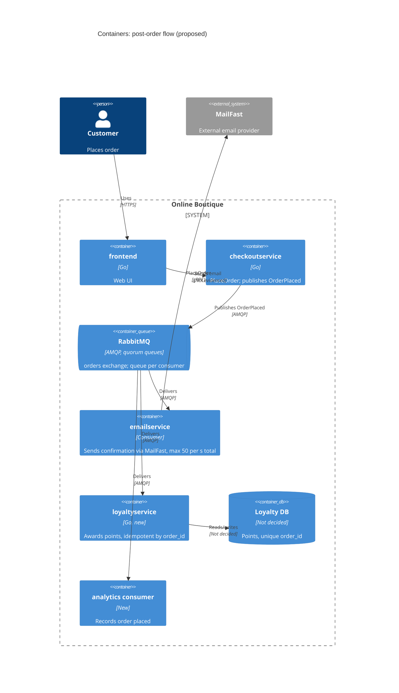

# ADR-0002: Publish OrderPlaced events via RabbitMQ for post-order actions

- **Status:** Proposed
- **Date:** 2026-10-24
- **Deciders:** สถาปนิก (ผู้เขียน ADR), ทีมพัฒนา 4 คน, ตัวแทน marketing

## Context and problem

R-12 (`docs/scenario.md`) กำหนดว่าหลังสั่งซื้อ ระบบต้อง (1) ส่งอีเมลยืนยันผ่าน **MailFast** แทน logic mock ของ `emailservice` (2) ให้ loyalty points ผ่าน `loyaltyservice` ที่จะสร้างใหม่ และ (3) บันทึก analytics event "order placed" ส่วน marketing คาดว่าปีหน้าจะมี post-order action เพิ่ม ได้แก่ SMS, fraud scoring และ recommendations update

**สถานะปัจจุบัน (Evidenced, `system/online-boutique/src/checkoutservice/main.go`):**

- `PlaceOrder` (บรรทัด 230) ทำงานแบบ synchronous ตามลำดับ: เตรียม order จาก cart, catalog และ currency ก่อน แล้วเรียก `chargeCard` (252), `shipOrder` (258), `emptyUserCart` (263) และ `sendOrderConfirmation` (273)
- ถ้าอีเมลล้มเหลว จะแค่ `log.Warnf` และ order ยังสำเร็จ (บรรทัด 273–274)
- downstream ทุกตัวต้องมี field, env var (`mustMapEnv`, 111–116) และ connection (`mustConnGRPC`, 122) ของตัวเอง ดังนั้นเพิ่ม action ใหม่หนึ่งตัว ต้องแก้ `checkoutservice` สามจุด
- `orderID` สร้างด้วย `uuid.NewUUID()` (233) ใช้เป็น idempotency key ได้
- **`checkoutservice` ไม่มี data store** และไม่บันทึก order ลงที่ใดเลย จึงไม่มี transaction ให้ผูก outbox ได้

**ข้อเท็จจริงจาก scenario:**

| หัวข้อ | ค่า |
|---|---|
| Checkout latency | p95 ของ `PlaceOrder` ≤ 500 ms (ปัจจุบันประมาณ 300 ms) |
| Peak | 200 orders/s ช่วง 11.11 |
| MailFast | p95 1.5 s, p99 8 s, ล้มเหลวประมาณ 0.5 %, rate limit 50 emails/s |
| Loyalty | ภายใน 1 นาที และ exactly once |
| Availability | order ต้องไม่ล้มเพราะ email, loyalty หรือ analytics |
| Team / Ops | 4 dev ถนัด Go/gRPC, 2 คนเคยใช้ RabbitMQ; ใช้ Kubernetes; เลือก open-source แบบ self-hosted |

**ปัญหา:** ถ้าเรียก MailFast แบบ synchronous ใน `PlaceOrder` latency ของ MailFast เพียงอย่างเดียว (p95 1.5 s) ก็เกินงบ 500 ms แล้ว นอกจากนั้น 200 orders/s มากกว่า rate limit 50/s ถึง 4 เท่า และ action ใหม่ทุกตัวต้องแก้ `checkoutservice`

## Decision drivers

1. **Availability:** order ห้ามล้มเพราะ post-order action
2. **Performance:** p95 ของ `PlaceOrder` ≤ 500 ms ที่ 200 orders/s (headroom ประมาณ 200 ms)
3. **Correctness:** loyalty ต้องได้ภายใน 1 นาที และ exactly once
4. **Modifiability:** เพิ่ม SMS, fraud scoring และ recommendations โดยไม่แก้ `checkoutservice`
5. **Rate limit:** รับ burst 200/s ได้ ทั้งที่ MailFast รับได้เพียง 50/s
6. **Operability / cost:** open-source, self-hosted, ทีมเล็ก

## Considered options

1. **Synchronous gRPC ต่อไป:** เพิ่ม `loyaltyservice` และ analytics เข้าไปใน `PlaceOrder` แล้วให้ `emailservice` เรียก MailFast
2. **Goroutine ใน `checkoutservice`:** เรียก downstream แบบ async ภายใน process เดียวกัน ไม่มี broker
3. **RabbitMQ pub/sub:** publish `OrderPlaced` หนึ่งครั้งไปที่ exchange แล้วให้ consumer แต่ละตัวมี queue ของตัวเอง
4. **Kafka (self-hosted):** publish ลง topic แล้วให้ consumer group แต่ละกลุ่มอ่านแยกกัน

### Pros and cons of the options

| Option | Pros | Cons |
|---|---|---|
| 1. Sync gRPC | ง่าย ใช้ pattern เดิม ไม่มี component ใหม่ | MailFast อยู่ใน critical path จึงเกิน 500 ms; ชน rate limit 50/s; downstream ที่ช้าทำให้ checkout ช้าตาม; ต้องแก้ checkout ทุกครั้งที่มี action ใหม่ |
| 2. Goroutine | ไม่กระทบ latency; ไม่มี component ใหม่ | งานหายเมื่อ pod restart จึงทำ exactly once ไม่ได้; ไม่มีที่พัก backlog ตอนชน rate limit; ยังต้องแก้ checkout ทุก action |
| 3. RabbitMQ | ตัด downstream ออกจาก critical path; durable queue มี ack, retry และ DLQ; queue แยกต่อ consumer ทำให้ email ที่ค้างไม่กระทบ loyalty; เพิ่ม consumer ได้โดยไม่แก้ checkout; open-source; ทีม 2 คนเคยใช้ | เพิ่ม stateful component; delivery เป็นแบบ at-least-once จึงต้องทำ consumer ให้ idempotent; ได้ผลแบบ eventual consistency; ถ้า publish ล้ม event หายเพราะไม่มี outbox |
| 4. Kafka | throughput สูง; replay ได้ ซึ่งเหมาะกับ analytics | operate หนักกว่าสำหรับทีม 4 คน; ไม่มีใครในทีมเคยใช้; 200/s ยังไม่ต้องใช้ Kafka; ต้องทำ rate limit ต่อ consumer เองเหมือนกัน |

## Decision

เลือก **Option 3: RabbitMQ** (deploy บน Kubernetes เป็น cluster 3 node และใช้ quorum queues)

- `checkoutservice` publish `OrderPlaced` (`order_id`, email, items, total) ไปที่ topic exchange `orders` **หลัง `shipOrder` สำเร็จ** และแทนที่การเรียก `sendOrderConfirmation` เดิม
- publish ด้วย **publisher confirms** และ timeout 100 ms (เป็น design parameter ไม่ใช่ข้อมูลจาก scenario) เพื่อให้รวมแล้วยังอยู่ใน headroom 200 ms
- ถ้า publish ล้มหรือ timeout ให้ order สำเร็จตามเดิม แต่เก็บ event ไว้ใน buffer ใน memory แล้ว retry แบบ backoff พร้อมเพิ่ม metric `orderplaced_publish_failed_total` และตั้ง alert ไว้
- consumer แต่ละตัวมี queue และ DLQ ของตัวเอง

| Consumer | หน้าที่ | กลไก |
|---|---|---|
| `emailservice` (เปลี่ยนเป็น consumer) | เรียก MailFast | rate limit **รวมทุก replica** ≤ 50/s (เช่น rate ต่อ pod = 50 / จำนวน replica); retry แบบ backoff เพราะล้มประมาณ 0.5 %; หมด retry ส่งลง DLQ |
| `loyaltyservice` (ใหม่) | ให้ points | unique constraint บน `order_id` ทำให้ redelivery ไม่ให้ points ซ้ำ; queue แยกจาก email จึงไม่ต้องรอ backlog ของ email |
| analytics consumer | บันทึก "order placed" | ทำงานอิสระ ยอมให้ข้อมูลช้าได้ |

**ทำไมเลือก RabbitMQ:** ตอบ driver 1, 2, 4 และ 5 ได้ตรงที่สุด ทีมมีประสบการณ์ และเป็น open-source แบบ self-hosted ส่วน Kafka ให้ replay ได้ แต่ยังไม่มี requirement ที่ต้องใช้ replay

**ข้อจำกัดที่ยอมรับ:** exactly once ฝั่ง consumer ทำได้ด้วย idempotency แต่ฝั่ง producer ยังไม่มี outbox เพราะ checkout ไม่มี DB ถ้า pod ล้มขณะที่ event ยังค้างใน buffer event นั้นจะหาย และลูกค้าไม่ได้ points ADR นี้รับความเสี่ยงนี้ไว้ชั่วคราว (ดู Risks)

## Consequences

- **Positive:** MailFast, loyalty และ analytics ไม่อยู่ใน critical path ของ `PlaceOrder` (availability, performance)
- **Positive:** email ที่ค้างช่วง peak ไม่กระทบ loyalty เพราะ queue แยกกัน (correctness, scalability)
- **Positive:** action ใหม่ผูกกับ exchange เดิมได้โดยไม่แก้ checkout (modifiability)
- **Positive:** open-source, self-hosted และทีมมีประสบการณ์อยู่บ้าง (cost, operability)
- **Negative:** ช่วง peak email ค้างเพิ่มประมาณ 150 ฉบับต่อวินาที (200 − 50) ระยะเวลาที่ลูกค้าต้องรออีเมลจึงขึ้นกับว่า peak นานเท่าไร (user-perceived performance)
- **Negative:** มี RabbitMQ cluster ที่ต้อง deploy, monitor และ upgrade (operability, cost)
- **Negative:** ต้องเขียน idempotency, retry และจัดการ DLQ; การ trace ข้าม service ยากขึ้น (testability)
- **Negative:** ฝั่ง producer ยังไม่ใช่ exactly once (ยังไม่มี outbox) (correctness)
- **Risks and mitigations:**

| Risk | Mitigation |
|---|---|
| publish ล้มแล้ว pod ตายก่อน retry ทำให้ event หาย และลูกค้าไม่ได้ points | metric และ alert บน publish failure; ADR ถัดไปพิจารณาเพิ่ม order store + outbox |
| RabbitMQ ล่ม | quorum queues 3 node; order ยังสำเร็จ และ event ไปรอใน buffer เพื่อ retry |
| email backlog โตไม่หยุดช่วง 11.11 | alert ที่ queue depth และ age; ตกลงกับ marketing เรื่อง SLA ของอีเมล |
| poison message | DLQ + alert |
| points ซ้ำจาก redelivery | unique `order_id` ใน loyalty DB |

## Validation

- **Load test** ที่ 200 orders/s โดยใช้ MailFast จำลอง (p95 1.5 s, p99 8 s, ล้ม 0.5 %, 50/s) ผ่านเกณฑ์เมื่อ p95 ของ `PlaceOrder` ≤ 500 ms
- **Fault injection:** ปิด RabbitMQ, `loyaltyservice` และ MailFast ทีละตัว ผ่านเกณฑ์เมื่อ order สำเร็จ 100 %
- **Loyalty:** ส่ง event ซ้ำโดยตั้งใจ ผ่านเกณฑ์เมื่อแต่ละ `order_id` ได้ points ครั้งเดียว และ p99 ของเวลาตั้งแต่ order จนได้ points ≤ 1 นาที
- **Metrics:** queue depth, age ของข้อความที่เก่าสุด, จำนวน DLQ, `orderplaced_publish_failed_total`
- **Review:** ทบทวน ADR นี้หลัง 11.11

## Open questions

1. peak 200 orders/s ยาวนานแค่ไหน และอีเมลช้าได้สูงสุดกี่นาที
2. ยอมรับให้ points หายได้บ้างไหม ในกรณีที่ publish ล้มแล้ว pod ตายพร้อมกัน ถ้าไม่ได้ ต้องเพิ่ม order store + outbox ใน ADR นี้เลย
3. analytics ต้องการ replay หรือไม่ ถ้าต้องการ ให้ทบทวน Kafka อีกครั้ง
4. ใครเป็นผู้ operate RabbitMQ และ HA ต้องเป็นระดับไหน
5. ใน event มีอีเมลลูกค้าอยู่ จะจัดการเรื่อง PII และการเข้ารหัสอย่างไร
6. MailFast รองรับ idempotency key เพื่อกันอีเมลซ้ำตอน retry หรือไม่
