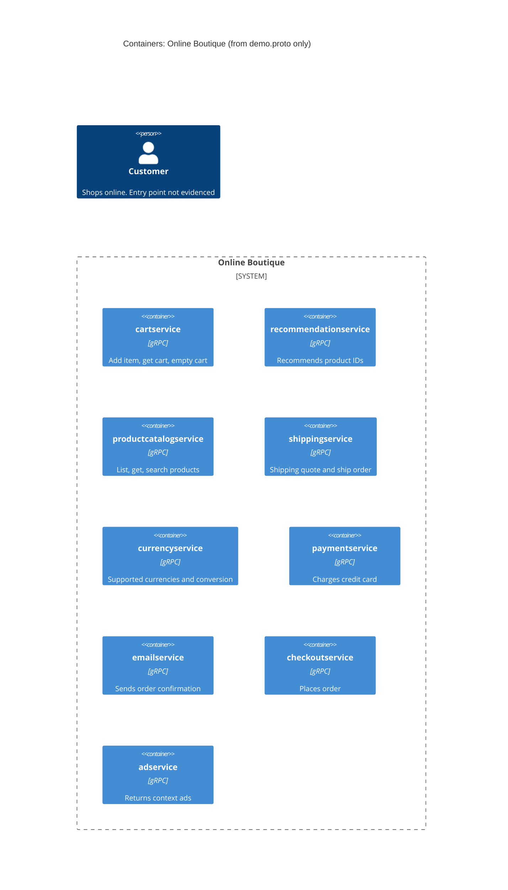

# Task 1A: Recovered architecture (C4 container level)

## 1. Agent

Claude Code (Anthropic), model Claude Opus 5.5 (`claude-opus-5-5`).

## 2. Files read

- `prompts/1-recover-architecture.md` (task file)
- `system/online-boutique/protos/demo.proto` (evidence)

## 3. Containers table

The evidence is one gRPC interface definition file. It shows which services exist and what API each one offers. It does **not** show implementation language, deployment, or data stores.

| Container | Technology / language | Responsibility | Evidence |
|---|---|---|---|
| `cartservice` | gRPC API (proto3). Implementation language not evidenced | Holds a user's cart: add item, get cart, empty cart | `system/online-boutique/protos/demo.proto` (`service CartService`: `AddItem`, `GetCart`, `EmptyCart`) |
| `recommendationservice` | gRPC API (proto3). Implementation language not evidenced | Returns recommended product IDs for a user and a list of products | `system/online-boutique/protos/demo.proto` (`service RecommendationService`: `ListRecommendations`) |
| `productcatalogservice` | gRPC API (proto3). Implementation language not evidenced | Lists, gets and searches products (name, description, picture, USD price, categories) | `system/online-boutique/protos/demo.proto` (`service ProductCatalogService`: `ListProducts`, `GetProduct`, `SearchProducts`; `message Product`) |
| `shippingservice` | gRPC API (proto3). Implementation language not evidenced | Quotes shipping cost for an address and items; ships an order and returns a tracking ID | `system/online-boutique/protos/demo.proto` (`service ShippingService`: `GetQuote`, `ShipOrder`) |
| `currencyservice` | gRPC API (proto3). Implementation language not evidenced | Lists supported currencies; converts `Money` between ISO 4217 currencies | `system/online-boutique/protos/demo.proto` (`service CurrencyService`: `GetSupportedCurrencies`, `Convert`) |
| `paymentservice` | gRPC API (proto3). Implementation language not evidenced | Charges a credit card for an amount and returns a transaction ID | `system/online-boutique/protos/demo.proto` (`service PaymentService`: `Charge`; `message CreditCardInfo`) |
| `emailservice` | gRPC API (proto3). Implementation language not evidenced | Sends an order confirmation to an email address | `system/online-boutique/protos/demo.proto` (`service EmailService`: `SendOrderConfirmation`) |
| `checkoutservice` | gRPC API (proto3). Implementation language not evidenced | Places an order from user ID, currency, address, email and card; returns an `OrderResult` | `system/online-boutique/protos/demo.proto` (`service CheckoutService`: `PlaceOrder`) |
| `adservice` | gRPC API (proto3). Implementation language not evidenced | Returns text ads for a set of page context keywords | `system/online-boutique/protos/demo.proto` (`service AdService`: `GetAds`) |

Notes:
- The service names in the first column are the proto service names in lower case. The actual deployment names are not evidenced in the provided files.
- `option go_package = "github.com/GoogleCloudPlatform/microservices-demo/hipstershop"` (line 19) only says where generated Go code goes. It does not show which language each service is written in.
- No data store (database, cache) and no message broker appear in the file. Not evidenced in the provided files.

## 4. Dependencies table

| Caller → callee | Protocol | Evidence |
|---|---|---|
| None evidenced | — | `demo.proto` defines only the server side of each API. It never states which service calls which. |

Every service exposes a gRPC API (`service … { rpc … }`), so any call between them would be gRPC. But the file has no client code, no addresses and no environment variables, so no caller → callee link can be proved.

## 5. Mermaid diagram

The diagram matches the two tables: nine containers, no proven dependencies, so no `Rel` lines. The end user is shown for completeness, but how the user reaches the system is not evidenced (see Gaps).

## 6. Gaps

| Gap | What the proto hints at | File that would settle it |
|---|---|---|
| Who calls whom | **[Inferred]** `PlaceOrderRequest` carries `CreditCardInfo`, `Address`, `email` and `user_currency`, and `OrderResult` has `shipping_tracking_id` and `shipping_cost`. So `checkoutservice` probably calls `cartservice`, `productcatalogservice`, `currencyservice`, `shippingservice`, `paymentservice` and `emailservice`. Not proved. | `system/online-boutique/kubernetes-manifests/checkoutservice.yaml` (`*_SERVICE_ADDR` env vars), checkout source code |
| User entry point (web frontend) | **[Inferred]** Something must call `GetCart`, `ListRecommendations`, `GetAds`, `PlaceOrder`, etc. for the user. No such service is in the proto. | `system/online-boutique/kubernetes-manifests/frontend.yaml`, frontend source code |
| Protocol between user and system | Not evidenced in the provided files (HTTP is likely but unproved) | `kubernetes-manifests/frontend.yaml` (ports, Service type), frontend source |
| Implementation language of each service | Not evidenced. `go_package` only names a Go package for generated code | Each service's source folder or Dockerfile under `system/online-boutique/src/` |
| Data store for the cart | **[Inferred]** Carts are kept per `user_id`, so state is stored somewhere | `kubernetes-manifests/cartservice.yaml` and any Redis/DB manifest |
| Other data stores, message brokers, external systems (e.g. real payment or email provider) | Not evidenced in the provided files | Full `system/online-boutique/kubernetes-manifests/` folder |
| Deployment names and ports | Not evidenced | `system/online-boutique/kubernetes-manifests/*.yaml` |
