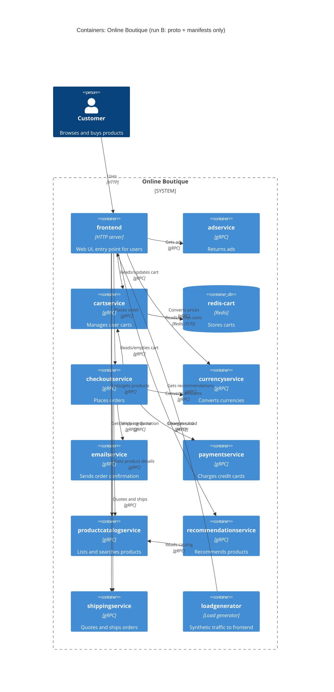

# Task 1, run B: Recovered architecture (C4 container level)

Evidence used: `system/online-boutique/protos/demo.proto`, `system/online-boutique/kubernetes-manifests/` (all files in it).

## 1. Agent

Claude Code (Anthropic CLI), model Claude Sonnet 5.5 (`claude-sonnet-5-5`).

## 2. Files read

- `prompts/1-recover-architecture.md` (task file)
- `system/online-boutique/protos/demo.proto`
- `system/online-boutique/kubernetes-manifests/README.md`
- `system/online-boutique/kubernetes-manifests/kustomization.yaml`
- `system/online-boutique/kubernetes-manifests/adservice.yaml`
- `system/online-boutique/kubernetes-manifests/cartservice.yaml`
- `system/online-boutique/kubernetes-manifests/checkoutservice.yaml`
- `system/online-boutique/kubernetes-manifests/currencyservice.yaml`
- `system/online-boutique/kubernetes-manifests/emailservice.yaml`
- `system/online-boutique/kubernetes-manifests/frontend.yaml`
- `system/online-boutique/kubernetes-manifests/loadgenerator.yaml`
- `system/online-boutique/kubernetes-manifests/paymentservice.yaml`
- `system/online-boutique/kubernetes-manifests/productcatalogservice.yaml`
- `system/online-boutique/kubernetes-manifests/recommendationservice.yaml`
- `system/online-boutique/kubernetes-manifests/shippingservice.yaml`

## 3. Containers table

Implementation languages are **not evidenced** in these files (images are only names such as `image: adservice`), so the technology column gives only what the evidence shows.

| Container | Technology | Responsibility | Evidence |
|---|---|---|---|
| frontend | HTTP server on 8080, gRPC client; language not evidenced | Web UI entry point for users; calls the backend services | `kubernetes-manifests/frontend.yaml` (httpGet `/_healthz`, `*_SERVICE_ADDR` env, Service `frontend-external` type LoadBalancer) |
| adservice | gRPC server, port 9555 | Returns ads for context keywords | `protos/demo.proto` (`service AdService`, `GetAds`); `kubernetes-manifests/adservice.yaml` (port 9555, grpc probe) |
| cartservice | gRPC server, port 7070 | Add item / get / empty a user's cart | `protos/demo.proto` (`service CartService`); `kubernetes-manifests/cartservice.yaml` (port 7070) |
| redis-cart | Redis (image `redis:alpine`), port 6379, `emptyDir` volume | Data store for carts | `kubernetes-manifests/cartservice.yaml` (Deployment `redis-cart`, `image: redis:alpine`, `volumes: emptyDir`) |
| checkoutservice | gRPC server, port 5050 | Places the order; orchestrates cart, catalog, currency, shipping, payment, email | `protos/demo.proto` (`service CheckoutService`, `PlaceOrder`); `kubernetes-manifests/checkoutservice.yaml` |
| currencyservice | gRPC server, port 7000 | Lists currencies, converts money | `protos/demo.proto` (`service CurrencyService`); `kubernetes-manifests/currencyservice.yaml` |
| emailservice | gRPC server, container 8080, Service port 5000 | Sends order confirmation | `protos/demo.proto` (`service EmailService`, `SendOrderConfirmation`); `kubernetes-manifests/emailservice.yaml` (port 5000 → targetPort 8080) |
| paymentservice | gRPC server, port 50051 | Charges a credit card | `protos/demo.proto` (`service PaymentService`, `Charge`); `kubernetes-manifests/paymentservice.yaml` |
| productcatalogservice | gRPC server, port 3550 | Lists, gets, searches products | `protos/demo.proto` (`service ProductCatalogService`); `kubernetes-manifests/productcatalogservice.yaml` |
| recommendationservice | gRPC server, port 8080 | Recommends product ids | `protos/demo.proto` (`service RecommendationService`); `kubernetes-manifests/recommendationservice.yaml` |
| shippingservice | gRPC server, port 50051 | Shipping quote and ship order | `protos/demo.proto` (`service ShippingService`); `kubernetes-manifests/shippingservice.yaml` |
| loadgenerator | Load-generating client; tool not evidenced | Synthetic users hitting the frontend (`USERS`, `RATE`). Not in `kustomization.yaml` (commented out), so not part of the default deployment | `kubernetes-manifests/loadgenerator.yaml`; `kubernetes-manifests/kustomization.yaml` (commented `loadgenerator.yaml`) |

## 4. Dependencies table

| Caller → Callee | Protocol | Evidence |
|---|---|---|
| Customer → frontend | HTTP | `kubernetes-manifests/frontend.yaml` (Service `frontend-external`, `type: LoadBalancer`, port name `http`) |
| loadgenerator → frontend | HTTP | `kubernetes-manifests/loadgenerator.yaml` (`FRONTEND_ADDR=frontend:80`, `wget http://${FRONTEND_ADDR}`) |
| frontend → productcatalogservice | gRPC | `frontend.yaml` (`PRODUCT_CATALOG_SERVICE_ADDR=productcatalogservice:3550`); `productcatalogservice.yaml` (Service port `grpc`); `demo.proto` (`ProductCatalogService`) |
| frontend → currencyservice | gRPC | `frontend.yaml` (`CURRENCY_SERVICE_ADDR=currencyservice:7000`); `currencyservice.yaml` (port `grpc`) |
| frontend → cartservice | gRPC | `frontend.yaml` (`CART_SERVICE_ADDR=cartservice:7070`); `cartservice.yaml` (port `grpc`) |
| frontend → recommendationservice | gRPC | `frontend.yaml` (`RECOMMENDATION_SERVICE_ADDR=recommendationservice:8080`); `recommendationservice.yaml` (port `grpc`) |
| frontend → shippingservice | gRPC | `frontend.yaml` (`SHIPPING_SERVICE_ADDR=shippingservice:50051`); `shippingservice.yaml` (port `grpc`) |
| frontend → checkoutservice | gRPC | `frontend.yaml` (`CHECKOUT_SERVICE_ADDR=checkoutservice:5050`); `checkoutservice.yaml` (port `grpc`) |
| frontend → adservice | gRPC | `frontend.yaml` (`AD_SERVICE_ADDR=adservice:9555`); `adservice.yaml` (port `grpc`) |
| checkoutservice → productcatalogservice | gRPC | `checkoutservice.yaml` (`PRODUCT_CATALOG_SERVICE_ADDR`) |
| checkoutservice → shippingservice | gRPC | `checkoutservice.yaml` (`SHIPPING_SERVICE_ADDR=shippingservice:50051`) |
| checkoutservice → paymentservice | gRPC | `checkoutservice.yaml` (`PAYMENT_SERVICE_ADDR=paymentservice:50051`); `demo.proto` (`PaymentService.Charge`) |
| checkoutservice → emailservice | gRPC | `checkoutservice.yaml` (`EMAIL_SERVICE_ADDR=emailservice:5000`); `emailservice.yaml` (Service port 5000 → 8080) |
| checkoutservice → currencyservice | gRPC | `checkoutservice.yaml` (`CURRENCY_SERVICE_ADDR=currencyservice:7000`) |
| checkoutservice → cartservice | gRPC | `checkoutservice.yaml` (`CART_SERVICE_ADDR=cartservice:7070`) |
| recommendationservice → productcatalogservice | gRPC | `recommendationservice.yaml` (`PRODUCT_CATALOG_SERVICE_ADDR=productcatalogservice:3550`) |
| cartservice → redis-cart | Redis protocol over TCP **[Inferred]** from image `redis:alpine`; TCP evidenced | `cartservice.yaml` (`REDIS_ADDR=redis-cart:6379`; redis-cart Service port `tcp-redis`, `tcpSocket` probe) |

Note on "gRPC": the manifests do not say "gRPC" for every caller. It is shown by the Service port name `grpc` / `grpc:` probes on each callee and by `demo.proto` defining a `service` for it. The caller using gRPC is therefore a consistent reading, not a direct statement in the caller's manifest.

## 5. Mermaid diagram

## 6. Gaps

| Gap | Why unclear | Extra file that would settle it |
|---|---|---|
| `shoppingassistantservice` | `frontend.yaml` sets `SHOPPING_ASSISTANT_SERVICE_ADDR=shoppingassistantservice:80`, but no manifest, no proto service, and the `shopping-assistant` kustomize component is commented out. Not added to the diagram. Port 80 hints at HTTP, not gRPC **[Inferred]**. | `system/online-boutique/kustomize/components/shopping-assistant/*`, frontend source |
| Implementation languages / frameworks | Manifests only give image names; proto has `go_package` but that is a generated-code option, not a service language. | `src/*/` sources, Dockerfiles, `skaffold.yaml` |
| Real image contents / versions | `image:` values are placeholders that skaffold replaces (`kubernetes-manifests/README.md`). | `skaffold.yaml`, `release/kubernetes-manifests.yaml` |
| Which services each caller really invokes | Env vars show the address is configured, not that it is called; e.g. `shippingservice` address given to both frontend and checkout, but which RPCs are used is unknown. | Frontend and checkout source (handlers / gRPC client code) |
| Whether cartservice speaks Redis protocol | Only the `redis:alpine` image and port 6379 are seen. | `src/cartservice` source |
| Persistence of carts | `redis-cart` uses `emptyDir: {}`, so data is lost on pod restart; whether this is intended is not stated. | Docs / ADRs, `kustomize/components/memorystore` |
| External systems (payment provider, SMTP, ad network, etc.) | No `System_Ext` is evidenced; the proto and manifests show no outbound calls beyond the cluster. Not claimed either way. | Source of `paymentservice`, `emailservice` |
| Optional `PACKAGING_SERVICE_URL` service | Only a commented-out env var in `frontend.yaml`. Not in diagram. | Frontend source / Google Cloud demo docs |
| Which container Customer reaches in practice | `frontend-external` is a `LoadBalancer`; whether an ingress or mesh sits in front is not in these files (`sidecar.istio.io/...` annotation hints at Istio **[Inferred]**, not evidenced as deployed). | `istio-manifests/*`, `kustomize/` |
| Sync vs async calls | The proto shows only unary-looking RPCs; no message broker evidenced. | n/a (nothing in evidence suggests one) |
