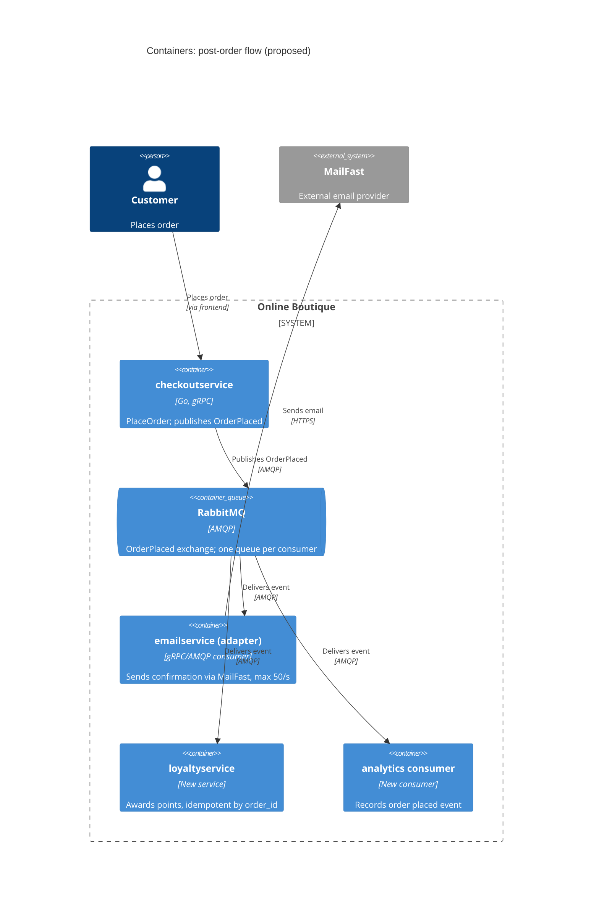

Agent: Claude Code, Sonnet 5.5 (claude-sonnet-5-5) | Run: b (with context) | Language: Thai

# ADR-0002: ใช้ message broker (RabbitMQ) แบบ publish/subscribe สำหรับ post-order actions

- **Status:** Proposed
- **Date:** 2026-10-24
- **Deciders:** ทีมพัฒนา Online Boutique (นักพัฒนา 4 คน) และตัวแทน marketing [ยังไม่ระบุชื่อ ดู Open questions]

## Context and problem

Requirement R-12 (`docs/scenario.md`) ต้องการให้หลัง order ถูกสร้าง ระบบทำ 3 อย่าง: (1) ส่งอีเมลยืนยันผ่าน **MailFast** (ผู้ให้บริการภายนอกรายใหม่ มาแทน logic mock ของ `emailservice`), (2) ให้ loyalty points ผ่าน `loyaltyservice` ใหม่, (3) บันทึก analytics event "order placed" ให้ทีม marketing นอกจากนี้ marketing คาดว่าปีหน้าจะมี post-order actions เพิ่ม (SMS, fraud scoring, recommendations update)

**สถานะปัจจุบัน (Evidenced):**

- `checkoutservice.PlaceOrder` เรียก `paymentservice` (`chargeCard`), `shippingservice` (`shipOrder`), `emptyUserCart` แล้วเรียก `emailservice` (`sendOrderConfirmation`) แบบ **synchronous gRPC ตามลำดับ** (`system/online-boutique/src/checkoutservice/main.go`, `PlaceOrder`)
- ถ้าอีเมลล้มเหลว โค้ดแค่ `log.Warnf` แล้ว order ยังสำเร็จ (`main.go`, บล็อก `if err := cs.sendOrderConfirmation(...)`)
- `checkoutService` struct เก็บ address/connection ของแต่ละ downstream แยกกัน (`emailSvcAddr`, `emailSvcConn` ฯลฯ) และต้องตั้ง env var ทุกตัวด้วย `mustMapEnv` ดังนั้นการเพิ่ม downstream ใหม่แต่ละตัวต้องแก้ struct, `main()`, และ `PlaceOrder` ของ `checkoutservice`
- `orderID` ถูกสร้างเป็น UUID ใน `PlaceOrder` (`uuid.NewUUID()`) จึงใช้เป็น idempotency key ได้ **[Inferred]**
- การเรียก `sendOrderConfirmation` ส่ง `ctx` ของ request เข้าไปโดยตรง; ใน `main.go` ไม่เห็น timeout เฉพาะสำหรับการเรียกนี้ (Not evidenced in the provided files ว่า timeout ถูกตั้งที่อื่น)

**ข้อเท็จจริงจาก scenario (`docs/scenario.md`):**

| หัวข้อ | ข้อเท็จจริง |
|---|---|
| Checkout latency | p95 ของ `PlaceOrder` ต้อง ≤ 500 ms (ปัจจุบันประมาณ 300 ms) |
| Peak load | 200 orders/s ช่วง 11.11 sale |
| MailFast | p95 1.5 s, p99 8 s, ล้มเหลวประมาณ 0.5 % ของ calls, rate limit 50 emails/s |
| Loyalty points | ต้องให้ภายใน 1 นาทีหลัง order และ **exactly once** |
| Availability | order ต้อง **ไม่ล้มเหลว** เพราะ email, loyalty หรือ analytics ล่ม |
| Team | 4 developers เก่ง Go และ gRPC; 2 คนเคยใช้ RabbitMQ |
| Operations | รันบน Kubernetes อยู่แล้ว; บริษัทเลือก open-source และ self-hosted มากกว่า managed แบบ cloud-only |

**ปัญหา:** ถ้าเพิ่ม MailFast, loyalty และ analytics เข้าไปใน `PlaceOrder` แบบ synchronous เหมือนเดิม latency จะเกินเป้า (MailFast p95 1.5 s อย่างเดียวก็เกิน 500 ms แล้ว), peak 200 orders/s ชน rate limit 50 emails/s ของ MailFast, และทุก action ใหม่ในอนาคตต้องแก้ `checkoutservice` อีก

## Decision drivers

1. **Availability:** order ต้องไม่ล้มเหลวเพราะ email, loyalty หรือ analytics ล่ม
2. **Performance:** p95 ของ `PlaceOrder` ≤ 500 ms ที่ 200 orders/s (ตอนนี้ประมาณ 300 ms จึงเหลือ headroom ประมาณ 200 ms)
3. **Reliability / correctness:** loyalty points ภายใน 1 นาที และ exactly once
4. **Modifiability:** เพิ่ม post-order action ใหม่ (SMS, fraud scoring, recommendations) โดยแก้ `checkoutservice` ให้น้อยที่สุด
5. **Scalability / การจัดการ rate limit:** รับ burst 200 orders/s ขณะที่ MailFast รับได้ 50 emails/s
6. **Cost และ operability:** open-source, self-hosted, รันบน Kubernetes; ทีมเล็ก (4 คน) และมีประสบการณ์ RabbitMQ 2 คน

## Considered options

1. **Synchronous gRPC ต่อไป:** `checkoutservice` เรียก MailFast (ผ่าน `emailservice`), `loyaltyservice` และ analytics ตามลำดับหรือขนานกันใน `PlaceOrder`
2. **Fire-and-forget ใน process เดียวกัน:** `checkoutservice` เปิด goroutine เรียก downstream แต่ละตัวแบบ asynchronous (ไม่มี broker)
3. **Event-driven ผ่าน RabbitMQ:** `checkoutservice` publish event `OrderPlaced` หนึ่งครั้ง แล้วแต่ละ consumer (email, loyalty, analytics) มี queue ของตัวเอง
4. **Event streaming ด้วย Kafka (self-hosted):** publish `OrderPlaced` เข้า topic แล้ว consumer groups อ่านแยกกัน

### Pros and cons of the options

| Option | Pros | Cons |
|---|---|---|
| 1. Synchronous gRPC | เข้าใจง่าย ตรงกับ pattern เดิมของ `PlaceOrder`; ทีมเก่ง Go/gRPC; ไม่มี component ใหม่ | MailFast p95 1.5 s / p99 8 s ทำให้ p95 ของ `PlaceOrder` เกิน 500 ms (ตัวเลข: 300 ms + 1,500 ms); ชน rate limit 50/s ที่ 200 orders/s; ทุก downstream ที่ล่มหรือช้าลาม latency ถึงลูกค้า; ต้องแก้ `checkoutservice` ทุกครั้งที่มี action ใหม่; exactly once ทำเองไม่ได้ถ้าไม่มี retry/idempotency |
| 2. Goroutine ใน `checkoutservice` | latency ของ `PlaceOrder` ไม่ถูกกระทบ; ไม่มี component ใหม่ | งานหายถ้า pod restart หรือ crash (ไม่ durable) จึงเสี่ยงต่อ loyalty "ภายใน 1 นาที"; ไม่มีที่พัก backlog เมื่อชน rate limit; retry ต้องเขียนเอง; ยังต้องแก้ `checkoutservice` เมื่อมี action ใหม่ |
| 3. RabbitMQ (pub/sub) | ตัด MailFast และ downstream ออกจาก critical path; durable queue + ack + retry + dead-letter; queue ของ email พัก backlog ได้เมื่อ 200/s > 50/s; consumer แยกกัน ล่มแยกกัน; เพิ่ม consumer ใหม่ (SMS, fraud) โดย `checkoutservice` ไม่ต้องรู้จัก; open-source self-hosted รันบน Kubernetes ได้; ทีม 2 ใน 4 เคยใช้ | เพิ่ม component stateful ที่ต้อง operate; ต้องออกแบบ idempotent consumer เพราะ delivery เป็น at-least-once; eventual consistency (email/points มาช้ากว่า order); ถ้า publish ล้มเหลวหลัง commit order ต้องมีกลไกกันงานหาย |
| 4. Kafka | throughput สูง, replay event ย้อนหลังได้ (ดีสำหรับ analytics); consumer groups แยกกัน | ใหญ่และ operate ยากกว่า RabbitMQ สำหรับทีม 4 คน; Not evidenced ว่าทีมมีประสบการณ์ Kafka; เกินความต้องการที่ 200 orders/s (scenario ไม่ได้ระบุปริมาณ event ที่ต้องใช้ replay) |

## Decision

เลือก **Option 3: ใช้ RabbitMQ แบบ publish/subscribe** ให้ `checkoutservice` publish event `OrderPlaced` (มี `order_id`, `email`, รายการสินค้า, ยอดรวม ฯลฯ) หลัง payment และ shipping สำเร็จ แล้วให้ consumer แยกกันรับไปทำงาน โดยแต่ละ consumer มี queue ของตัวเอง:

| Consumer | หน้าที่ | หมายเหตุ |
|---|---|---|
| email consumer (adapter บาง ๆ ของ `emailservice` เรียก MailFast) | ส่งอีเมลยืนยัน | จำกัดอัตราไม่เกิน 50 emails/s ตาม rate limit; retry เมื่อล้มเหลว (~0.5 %); ใช้ dead-letter queue เมื่อ retry หมด |
| `loyaltyservice` (ใหม่) | ให้ points | idempotent โดยใช้ `order_id` เป็น key (unique) เพื่อให้ได้ exactly once ในผลลัพธ์ แม้ broker ส่งซ้ำ |
| analytics consumer | บันทึก "order placed" | แยกกันจากสองตัวแรก |

เหตุผลเทียบกับ decision drivers:

- **Availability:** การ publish ไม่ผูกกับความสำเร็จของ downstream ใด ๆ; ถ้า publish ล้มเหลว `checkoutservice` ต้อง log แล้วปล่อยให้ order สำเร็จ (สอดคล้องกับ pattern เดิมที่ email ล้มเหลวแล้วแค่ `log.Warnf`) พร้อมกลไกกันงานหาย (ดู Risks)
- **Performance:** เพิ่มเวลาใน `PlaceOrder` เพียงการ publish หนึ่งครั้งซึ่งเป็นงานเล็ก [ต้องวัดจริง ดู Validation] จึงน่าจะอยู่ใน headroom ประมาณ 200 ms; MailFast p95 1.5 s ไม่อยู่ใน critical path
- **Rate limit:** queue ของ email ทำหน้าที่ buffer; ที่ 200 orders/s ส่งได้ 50/s ดังนั้น backlog โตประมาณ 150 emails/s ตลอดช่วง peak (คำนวณจาก scenario) อีเมลจึงช้าลง แต่ไม่กระทบ order หรือ loyalty เพราะ queue แยกกัน
- **Exactly once:** broker รับประกันได้เพียง at-least-once จึงใช้ idempotent consumer ที่ `loyaltyservice` และ loyalty queue แยกจาก email ที่ช้า จึงมีโอกาสให้ points ภายใน 1 นาทีแม้ email มี backlog
- **Modifiability:** SMS, fraud scoring และ recommendations update เพิ่มเป็น consumer ใหม่ผูกกับ exchange เดิม โดยไม่แก้ `checkoutservice` (ต่างจาก Option 1 และ 2)
- **Cost/operability:** RabbitMQ เป็น open-source self-hosted ตรงกับนโยบายบริษัท และมีคน 2 ใน 4 คนที่เคยใช้; เหมาะกว่า Kafka สำหรับทีมขนาดนี้

ภาพรวม (ส่วนที่เพิ่มใหม่):

(ลูกศร `Customer -> checkoutservice` ย่อขั้น `frontend` ออก; โปรโตคอล HTTPS ของ MailFast เป็น **[Assumption]** เพราะ scenario ไม่ได้ระบุ)

## Consequences

- **Positive:** `PlaceOrder` ไม่ถูก MailFast, `loyaltyservice` หรือ analytics ทำให้ช้าหรือล้ม (availability, performance)
- **Positive:** email backlog ช่วง peak ไม่กระทบ loyalty เพราะแยก queue (reliability, scalability)
- **Positive:** เพิ่ม post-order action ใหม่โดยไม่แก้ `checkoutservice` และไม่ต้องเพิ่ม connection/env var ต่อ downstream (modifiability)
- **Positive:** ใช้ open-source self-hosted ตามนโยบาย (cost, operability)
- **Negative:** มี stateful component เพิ่มอีกหนึ่งตัวให้ deploy, monitor, backup (operability, cost)
- **Negative:** eventual consistency: ลูกค้าอาจได้อีเมลช้าช่วง peak (ประมาณ 150 emails/s สะสมต่อวินาทีที่เกิน rate limit) และ points ปรากฏหลัง order ไม่กี่วินาที (user-perceived performance)
- **Negative:** ต้องเขียน idempotency, retry, dead-letter handling ใน consumer; debug flow ยากขึ้นเพราะกระจายหลาย service (modifiability, testability)
- **Negative:** `checkoutservice` ไม่เคยมี dependency ต่อ broker จึงต้องเพิ่ม client และ config ใหม่ (modifiability ระยะสั้น)
- **Risks and mitigations:**

| Risk | Mitigation |
|---|---|
| RabbitMQ เป็น single point of failure ของ post-order flow | ใช้ cluster/quorum queues และ persistent messages [รายละเอียดการ deploy ยังเป็น Open question]; ถ้า broker ล่ม order ต้องยังสำเร็จ |
| Publish ล้มเหลวหลัง payment/shipping สำเร็จ ทำให้ event หาย (points/email ไม่ถูกส่ง) | ใช้ transactional outbox หรือ retry buffer ฝั่ง `checkoutservice` **[Inferred]** เพราะ `main.go` ไม่แสดง data store ของ checkout; ต้องตัดสินใจเพิ่ม (Open questions) |
| ได้ points ซ้ำจาก redelivery | unique constraint บน `order_id` ใน `loyaltyservice` |
| Email backlog โตไม่หยุดช่วง 11.11 | monitor ความยาว queue; กำหนด TTL/นโยบายเมื่อค้างนานเกินไป (Open questions) |
| Poison message ทำให้ consumer ติดลูป | dead-letter queue + alert |
| ทีมยังไม่ชำนาญ RabbitMQ (เคยใช้ 2 ใน 4 คน) | ให้คนที่เคยใช้เป็นเจ้าของ pattern และ review; เริ่มจาก consumer เดียว |

## Validation

- **Load test** ที่ 200 orders/s (จำลอง 11.11 ด้วย Locust `loadgenerator` หรือเครื่องมือเทียบเท่า) โดยจำลอง MailFast ที่ p95 1.5 s / p99 8 s / fail 0.5 % / rate limit 50/s และตรวจว่า p95 ของ `PlaceOrder` ≤ 500 ms
- **Fault injection:** หยุด `loyaltyservice`, MailFast และ RabbitMQ ทีละตัว แล้วตรวจว่า order สำเร็จ 100 %
- **Loyalty correctness:** ส่ง event ซ้ำโดยตั้งใจ ตรวจว่าได้ points ครั้งเดียวต่อ `order_id` และ p99 ของเวลาจาก order ถึง points ≤ 1 นาที
- **Metrics ที่ติดตาม:** queue depth และ age ของข้อความที่เก่าสุดแต่ละ queue, จำนวน dead-letter, อัตราสำเร็จของ MailFast
- **Review:** ทบทวน ADR นี้หลัง 11.11 sale ครั้งแรก

## Open questions

ข้อมูลที่ไม่มีใน context ที่ได้รับ (ไม่ได้เดาตัวเลข):

1. ช่วง 11.11 peak 200 orders/s นานเท่าไร? (ใช้ประเมินขนาด email backlog: ส่วนเกินประมาณ 150 emails/s คูณระยะเวลา) และอีเมลที่ช้ากี่นาทีที่ธุรกิจยอมรับได้?
2. ต้องส่งอีเมลยืนยันภายในกี่นาทีหลัง order (SLA ของอีเมล)? Scenario ระบุ SLA เฉพาะ loyalty (1 นาที)
3. Analytics event ต้องมี schema, ความสด (freshness) และปลายทางอะไร? ยอมให้สูญหายบางส่วนได้หรือไม่?
4. `checkoutservice` มี data store สำหรับ transactional outbox หรือไม่ (ไม่เห็นใน `main.go`)? ถ้าไม่มี ยอมรับ trade-off ใดระหว่างความเสี่ยง event หายกับความซับซ้อนที่เพิ่ม?
5. RabbitMQ ต้อง deploy แบบ HA (กี่ node) และใครรับผิดชอบ operate? งบประมาณและ SLA ของ broker ไม่ได้ระบุ
6. `emailservice` เดิมจะคงอยู่เป็น consumer adapter หรือถูกแทนที่ทั้งหมดด้วย service ใหม่? (ADR นี้สมมติว่าคงไว้เป็น adapter **[Assumption]**)
7. `loyaltyservice` ใช้ data store อะไร และกฎคำนวณ points คืออะไร? (ยังไม่ระบุ)
8. MailFast ต้องใช้ idempotency key เพื่อกันอีเมลซ้ำเมื่อ retry หรือไม่? (ไม่ระบุ)
9. ข้อกำหนดด้านข้อมูลส่วนบุคคล (อีเมลลูกค้าใน event) และการเข้ารหัสในการส่งผ่าน broker?
10. Marketing ต้องการ replay event ย้อนหลังหรือไม่? ถ้าใช่ ควรทบทวน Option 4 (Kafka)
